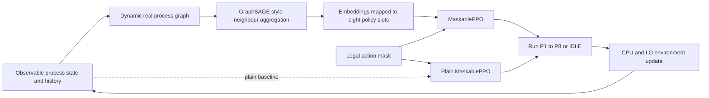

# CPU Scheduling Lab Evolution Diagram

```mermaid
flowchart TD
    A[Problem definition<br/>Learn CPU scheduling without kernel modification]
    B[FCFS SJF Round Robin]
    C[Shared workloads and seeded benchmarks]
    D[Process types and strict Type Priority]
    E[First Gymnasium and PPO prototype]
    F[Hide future CPU and I O information]
    G[Random workloads and process positions]
    H[Multiple CPU and I O bursts<br/>READY BLOCKED FINISHED]
    I[Observable process history]
    J[IDLE and MaskablePPO]
    K[Soft type weights and aging]
    L[Plain RL seeded benchmark]
    M[Dynamic process graph<br/>contention type history]
    N[First GCN diagnostic]
    O[Problem: over smoothing<br/>nearly identical node scores]
    P[GraphSAGE style aggregation]
    Q[GraphSAGE feature extractor inside MaskablePPO]
    R[Problem: fixed three process interface]
    S[MAX PROCESSES 8<br/>zero padding fixed actions unused slot masks]
    T[Real process graph mapped to fixed PPO slots]
    U[Variable size training and 1 3 5 8 tests]
    V[500 identical seeded workload benchmark]
    W[Streamlit Step mode visualization]

    A --> B --> C --> D --> E
    E --> F --> G --> H --> I --> J --> K --> L
    L --> M --> N --> O --> P --> Q
    Q --> R --> S --> T --> U --> V --> W
```

## Current architecture

## Interpretation

The project did not jump directly from classical scheduling to Graph-RL. Each stage addressed a problem revealed by the previous stage: unfair information, memorization, starvation, impossible actions, unrealistic process behaviour, graph over-smoothing, fixed process count, and ambiguous metrics. The final frontend makes those design decisions visible one scheduling step at a time.

